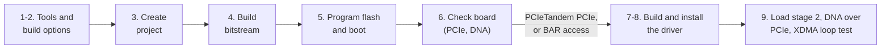

# Build and test guide

Step by step: rebuild the example Vivado project, program the board, and build, install and test the Windows driver.
For how PCIe Tandem works, see [PCIe_Tandem.md](PCIe_Tandem.md); for the driver internals, see
[driver/windows/README.md](../driver/windows/README.md).

Branch: `Vivado_2019_2_Tandem` (Vivado 2019.2). Last updated: 2026-10-22.



- [1. What you need](#1-what-you-need)
- [2. Choose the build options](#2-choose-the-build-options)
- [3. Create the project](#3-create-the-project)
- [4. Build the bitstream](#4-build-the-bitstream)
- [5. Program the flash and boot](#5-program-the-flash-and-boot)
- [6. Check the board](#6-check-the-board)
- [7. Build the driver](#7-build-the-driver)
- [8. Install the driver](#8-install-the-driver)
- [9. Test the driver](#9-test-the-driver)
- [10. Troubleshooting](#10-troubleshooting)
- [11. Verification status](#11-verification-status)

## 1. What you need

**Hardware**

- FK33 (XCVU33P) or FK35 (XCVU35P) board, with a JTAG cable on its JTAG header.
- For PCIe: a PC slot with an x16 connector. Jumper P7 on pins 7-8 (PRSNT, x16).

**Software**

- Vivado 2019.2 (2019.2.1 tested) with a license for VU33P/VU35P (Enterprise or evaluation; the free Standard edition
  does not cover these parts). The `.bat` scripts use `XILINX_VIVADO`, or `C:\Xilinx\Vivado\2019.2` if it is not set.
- A short work folder, for example `C:\work\fk35`. Out-of-context IP runs fail when paths get near the Windows
  260-character limit.
- For the Windows driver: Windows 10 (1709 or later) or 11, 64-bit; the
  [Enterprise WDK](https://learn.microsoft.com/en-us/windows-hardware/drivers/download-the-wdk) ISO (build 28000.2526
  tested); Secure Boot off and test signing on (step 8).

The project script sets the part directly, so the board files in `board_files` are optional for it (add them to
Vivado as described in the [README](../README.md) for your own projects).

## 2. Choose the build options

The options are at the top of `projects/sqrl_fk_project.tcl`:

| Option | Values | This branch | Notes |
| --- | --- | --- | --- |
| `Board` | `FK33`, `FK35` | `FK35` | Same PCB; the project is `SQRL_FK33` or `SQRL_FK35` |
| `EnablePCIe` | `1`, `0` | `1` | `0` builds a JTAG-only design |
| `PCIeLanes` | `1`, `4`, `8`, `16` | `8` | |
| `PCIeGen` | `1` to `4` | `4` | Gen4 up to x8, x16 up to Gen3 |
| `HBMGlobalSwitch` | `1`, `0` | `1` | |
| `PCIeTandem` | `None`, `PROM`, `PCIe` | `PROM` | See the table below |
| `FlashPart`, `FlashSizeMB` | | `mt25qu256-spi-x1_x2_x4_x8`, `64` | Two MT25QU256 in dual QSPI (SPIx8) |

| `PCIeTandem` | Flash holds | After power-on | Needs the driver |
| --- | --- | --- | --- |
| `None` | full bitstream | configured after about 150 ms: on a cold boot the PC may not see the board | no |
| `PROM` | stage 1 + stage 2 | PCIe after about 25 ms, the whole design about 140 ms later | no |
| `PCIe` | stage 1 only | PCIe after about 25 ms; the rest waits for the driver | yes, `sqrl_fk_mcap load` after every power-on |

## 3. Create the project

In the Vivado 2019.2 Tcl console (GUI), from the work folder:

```tcl
cd C:/work/fk35
source D:/Projects/_github/SQRL_FK33/projects/sqrl_fk_project.tcl
```

The script **deletes** `SQRL_FK35` (or `SQRL_FK33`) and `.Xil` in the current folder first, then creates the project
there. Expected messages:

- 32 critical warnings `[BD 41-1377]` during address assignment: 2019.2 maps segments before excluding them; they go
  away, and `validate_bd_design` passes.
- With the board on JTAG: `Hardware Manager: added mt25qu256-spi-x1_x2_x4_x8 to xcvu35p_0`. Without it, a warning that
  the configuration memory was not added (the flash scripts set it up later anyway).

Besides the project, the folder gets generated files: `sqrl_fk_tandem.xdc` and `tandem_place_pre.tcl` (Tandem builds),
`write_flash_image.tcl`, `program_flash.tcl`, and copies of the flash and DNA scripts from `scripts/`.

## 4. Build the bitstream

**GUI:** Flow Navigator, Generate Bitstream.

**Script:** in the same Tcl console, right after the project script:

```tcl
# 2019.2: create the out-of-context IP runs explicitly, otherwise synth_1 fails with "module ... not found".
generate_target all [get_files bd.bd]
create_ip_run [get_files bd.bd]
# Threads: set before launch_runs so the runs get it (2019.2 defaults are 2, synthesis allows up to 8).
set_param general.maxThreads 24
set_param synth.maxThreads 8
launch_runs impl_1 -to_step write_bitstream -jobs 24
```

A full build takes about 35 minutes on an i9-14900K with 24 threads. Results in `SQRL_FK35/SQRL_FK35.runs/impl_1`:

| `PCIeTandem` | Bitstream | Flash images (written after `write_bitstream`) |
| --- | --- | --- |
| `None`, `PROM` | `bd_wrapper.bit` | `bd_wrapper_primary.mcs/.prm`, `bd_wrapper_secondary.mcs/.prm` |
| `PCIe` | `bd_wrapper_tandem1.bit` (stage 1), `bd_wrapper_tandem2.bit` (stage 2, for the driver) | same names, stage 1 only |

**Check the result** (Reports, or `runme.log` in `impl_1`): timing met (`Post Routing Timing Summary`, WNS and WHS
not negative) and these expected warnings only:

- 6 critical warnings `[Common 17-55]` for `sqrl_fk.xdc` lines 87-92: the `sysref` clock pins exist only in
  JTAG-only designs.
- `REQP-1852` (cascaded clock buffers in `clk_wiz_0`) and `RTSTAT-10` (nets without loads).
- Tandem PCIe only: `HDTC-14`, three slices next to the stage 1 area hold stage 2 registers (see
  [PCIe_Tandem.md](PCIe_Tandem.md)).

Reference builds (FK35, Gen4 x8):

| Build | Date | WNS / WHS (ns) | Stage 1 | Stage 2 | Flash image |
| --- | --- | --- | --- | --- | --- |
| Tandem PROM | 2026-10-21 | +0.087 / +0.010 | 26.0 Mbit | 144.1 Mbit | 21.3 MB (both stages) |
| Tandem PCIe, DNA port fix | 2026-10-22 | +0.008 / +0.010 | 28.2 Mbit | 146.5 Mbit | 3.5 MB (stage 1) |

## 5. Program the flash and boot

Both scripts program the two flashes, verify them, boot the FPGA from them and check DONE. Run them in the project
folder (`C:\work\fk35\SQRL_FK35`), where the project script copied them; without an argument they use the `.xpr` there.

- **Board not in a running PC** (or powered separately):

  ```bat
  sqrl_fk_program_flash.bat
  ```

- **Board in this PC, Windows running:** reconfiguring the FPGA takes the PCIe link down, which crashes Windows unless
  the device is disabled first. This script disables it, programs and boots, then removes the old device and rescans, so
  Windows finds the new design without a restart (it asks for administrator rights):

  ```bat
  sqrl_fk_program_flash_pc.bat
  ```

Programming time grows with the image size: the 21 MB Tandem PROM image took about 21 minutes; a Tandem PCIe image
(stage 1 only, 3.5 MB) is much smaller. The end of a good run:

```text
xcvu35p_0 booted from flash: DONE=1
Scanning for the new design...
PCIe device back: PCI\VEN_1E24&DEV_1533&..., link Gen4 x4, no driver installed
```

In the Vivado GUI instead: `source SQRL_FK35/program_flash.tcl`, or Hardware Manager, Program Configuration Memory
Device (the flash part and files are filled in).

## 6. Check the board

**PCIe in Windows** (Device Manager shows "PCI Device" without the driver, or "SQRL Forest Kitten FK33/FK35" with it):

```powershell
Get-PnpDevice -InstanceId 'PCI\VEN_1E24&DEV_1533*' | ForEach-Object {
    Get-PnpDeviceProperty -InstanceId $_.InstanceId -KeyName DEVPKEY_PciDevice_CurrentLinkSpeed, DEVPKEY_PciDevice_CurrentLinkWidth
}
```

Link speed 4 is Gen4. The test PC's slot gives x4.

**Device DNA over JTAG** (any build with the design loaded):

```bat
sqrl_fk_read_dna.bat
```

It prints the eFUSE DNA and the design's copy (`dna_reader`), and says whether they match. A Tandem PCIe board at stage
1 has no design DNA yet.

**Cold boot (Tandem builds):** shut Windows down, switch the PC off at the power supply for a few seconds, switch on.
The board must be in Device Manager after boot. A Tandem PCIe board is then at stage 1 until the driver loads stage 2.

## 7. Build the driver

Mount the EWDK ISO (double-click it in Explorer), then:

```bat
cd D:\Projects\_github\SQRL_FK33\driver\windows
build.bat
```

`build.bat` finds the mounted EWDK on any drive (or set `EWDK` to its drive or folder), builds the KMDF driver
`sqrlfk.sys` with MSBuild and `sqrl_fk_mcap.exe` with `cl`, test-signs the driver, makes the catalog with `inf2cat`
and checks the INF with `infverif`. It ends with `Driver package: ...\package (test-signed with certificate ...)`.
The package in `driver\windows\package`: `sqrlfk.sys`, `sqrlfk.inf`, `sqrlfk.cat`, `sqrlfk.cer`, `sqrlfk.pdb`,
`sqrl_fk_mcap.exe`, `install.bat`. The first build creates the code signing certificate `CN=SQRL FK Test Driver` in your
user certificate store. `build.bat analyze` also runs the compiler's static analysis with the WDK driver rules.

## 8. Install the driver

Once per PC:

1. Secure Boot off (firmware setup).
2. In an administrator prompt, then restart Windows ("Test Mode" appears on the desktop):

   ```bat
   bcdedit /set testsigning on
   ```

Then, after each driver build:

3. Run `driver\windows\package\install.bat`. It asks for administrator rights; then Windows asks whether to install a
   driver from an unverified publisher: install it. The test certificate is not added to any trusted store.
4. Device Manager, System devices: "SQRL Forest Kitten FK33/FK35".

To remove it: `install.bat /uninstall`. To leave test mode: `bcdedit /set testsigning off` and restart.

## 9. Test the driver

In an administrator prompt in `driver\windows\package` (only Administrators and SYSTEM can open the device):

**Any build:**

```bat
sqrl_fk_mcap info
sqrl_fk_mcap dna
```

`info` prints the PCI location, the mapped BARs (BAR0 128 KB is the AXI-Lite bus, BAR2 64 KB the XDMA registers),
the XDMA engine identifiers and DMA buffer size, and, for Tandem PCIe builds, the MCAP registers. `dna` reads the
design's DNA over PCIe; it must equal the eFUSE DNA from `sqrl_fk_read_dna.bat`.

**XDMA loop test** (any build with stage 2 running):

```bat
sqrl_fk_mcap loop
```

For each target it writes a pseudo-random pattern from host memory to the card with the H2C engine, reads it back
with the C2H engine and compares, 10 times (`-n <count>` to change). The bandwidth is the engine run time measured in
the driver, without the copies in Windows. Targets on the XDMA AXI port:

| Target | AXI address | Size tested |
| --- | --- | --- |
| BRAM (on chip, DMA loop test only) | 0x2_0000_0000 | 256 KB |
| HBM stack 0 | 0x0_0000_0000 | the driver's DMA buffer (4 MB) |
| HBM stack 1 | 0x1_0000_0000 | the driver's DMA buffer (4 MB) |

Each target prints a line ending in `data OK`, or the first wrong word and how many differ. `loop <address> [<bytes>]`
tests one address. The BRAM needs a build from 2026-10-22 or later; an older build fails that target (engine error)
while the HBM targets still work. On the test PC (Gen4 x4, 7.88 GB/s raw per direction):

```text
XDMA loop test, channel 0, DMA buffer 4096 KB, 10 iterations per target
BRAM         0x200000000   256 KB x 10: H2C  6409 MB/s, C2H  6309 MB/s, data OK
HBM stack 0  0x000000000  4096 KB x 10: H2C  7091 MB/s, C2H  6866 MB/s, data OK
HBM stack 1  0x100000000  4096 KB x 10: H2C  7093 MB/s, C2H  6869 MB/s, data OK
```

**All tests in one go:** `scripts\sqrl_fk_pcie_test.bat [stage2.bit]` runs the steps below in order: board and boot
state, `info`, `load`, `dna`, `loop`. Edit the paths at its top for your build (stage 2 bitstream, driver package, loop
iterations, log file). It asks for administrator rights, stops after a failed `load`, and writes everything to
`%TEMP%\sqrl_fk_pcie_test.log`.

**Tandem PCIe build** (flash programmed with that build, step 5):

1. `sqrl_fk_mcap info`: an MCAP capability is found (configuration offset 0x350 on the FK35), `EOS=0` and
   `DESIGN_SWITCH=0` (stage 1 only), and the XDMA engines read `0xFFFFFFFF` (they are in stage 2).
2. Load stage 2 from the same build (about 11 s for the FK35, with a progress counter):

   ```bat
   sqrl_fk_mcap load C:\work\fk35\SQRL_FK35\SQRL_FK35.runs\impl_1\bd_wrapper_tandem2.bit
   ```

   It ends with `Stage 2 loaded in ... s: end of startup` and the MCAP registers with `DESIGN_SWITCH=1`. The JTAG ID
   now reads the FPGA's ID code (`0x14B71093` for this XCVU35P). The status read after MCAP releases the configuration
   engine shows `EOS=0` again; that is normal.
3. `sqrl_fk_mcap dna`: the DNA equals the eFUSE DNA.
4. `sqrl_fk_mcap loop`: all three targets `data OK`.
5. After every power-on, repeat step 2 (or run `scripts\sqrl_fk_pcie_test.bat`): stage 2 is not stored on the board.

| Message | Meaning |
| --- | --- |
| `Cannot open \\.\SqrlFk0` | Driver not installed, not an administrator prompt, or the board is not in Windows |
| `No MCAP capability` | Not a Tandem PCIe build |
| `BAR0 reads all ones` | Stage 2 is not loaded (or its design switch is off) |
| `The design switch is on: stage 2 is already loaded` | Nothing to do; a stage 2 must be loaded only once after stage 1 |
| `Stage 2 failed: MCAP status ...` | Wrong file (stage 2 from another build) or a load error: power-cycle and load again |
| `... DMA ... failed: no XDMA engine` | Stage 2 is not loaded |
| `... DMA ... failed: engine error, engine status ...` | Nothing at that AXI address (for example the BRAM in an older build), or an AXI error |
| `... DMA ... failed: timeout` | The AXI target did not answer (for example HBM not calibrated); power-cycle before more DMA tests |

## 10. Troubleshooting

| Problem | Cause | What to do |
| --- | --- | --- |
| Board not in Device Manager after a boot | The FPGA was not configured when the BIOS scanned the slot (full bitstream too slow, or empty flash) | Use a Tandem build; after flashing use `sqrl_fk_program_flash_pc.bat` or restart Windows |
| Windows freezes or crashes when the FPGA is reprogrammed | The PCIe link went down under an enabled device | Disable the device first, or use `sqrl_fk_program_flash_pc.bat` |
| `synth_1` fails: `module bd_axi_iic_0_0 not found` | Scripted build without the out-of-context IP runs | `generate_target` and `create_ip_run` before `launch_runs` (step 4) |
| Out-of-context runs fail on file paths | Work folder path too long | Use a short work folder |
| Design DNA differs from the eFUSE DNA, upper bits equal | `DNA_PORTE2` placed in another SLR, which has its own DNA | Rebuild: `sqrl_fk.xdc` places it in SLR0 since 2026-10-22 |
| Driver error code 52 in Device Manager | Test signing off, or Secure Boot on | Step 8 |
| `build.bat`: `Enterprise WDK not found` | EWDK ISO not mounted | Mount it, or set `EWDK` to its drive or folder |
| `pnputil` or `install.bat` cannot find the board | Board not enumerated | Check step 6 first |

## 11. Verification status

Update this table after every hardware test.

| What | Build | Date | Result |
| --- | --- | --- | --- |
| Flash programming (SPIx8, 2 x MT25QU256) and boot from flash | non-Tandem | 2026-10-21 | passed |
| Design DNA = eFUSE DNA (fixed `dna_reader`) | non-Tandem | 2026-10-21 | passed |
| Re-enumeration without restart (`sqrl_fk_program_flash_pc.bat`) | non-Tandem, Tandem PROM | 2026-10-21 | passed |
| Tandem PROM build | Tandem PROM | 2026-10-21 | timing met |
| Tandem PROM: flash, boot over JTAG, enumerated Gen4 x4 | Tandem PROM | 2026-10-21 | passed |
| Tandem PROM: cold power-on enumeration | Tandem PROM | | not reported yet |
| Tandem PROM: design DNA | Tandem PROM | 2026-10-21 | failed (SLR1 DNA); fixed in constraints 2026-10-22, fix confirmed on the Tandem PCIe build 2026-10-23 |
| Tandem PCIe build with the DNA fix | Tandem PCIe | 2026-10-22 | timing met, DNA port in SLR0 |
| Driver 2.0 (KMDF, EWDK): build, static analysis, `inf2cat`, `infverif /w` | | 2026-10-22 | passed |
| Driver 2.0 installed (test signing), `info` at stage 1: BAR0 128 KB, BAR2 64 KB, 4 MB DMA buffer, MCAP at 0x350 | Tandem PCIe + DMA BRAM | 2026-10-23 | passed |
| MCAP stage 2 load (18.1 MB in 11.4 s; JTAG ID 0x14B71093 afterwards, design switch on) | Tandem PCIe + DMA BRAM | 2026-10-23 | passed |
| Design DNA over PCIe (BAR0) = eFUSE DNA, DNA port in SLR0 | Tandem PCIe + DMA BRAM | 2026-10-23 | passed |
| XDMA loop test, Gen4 x4: BRAM 256 KB 6.4/6.3 GB/s, HBM stack 0 and 1 4 MB 7.1/6.9 GB/s (H2C/C2H), data OK | Tandem PCIe + DMA BRAM | 2026-10-23 | passed |
| Tandem PCIe: cold power-on, then stage 2 load | Tandem PCIe | | not tested yet |
