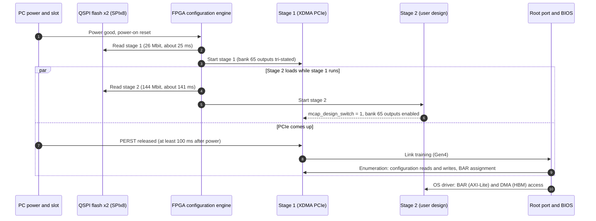
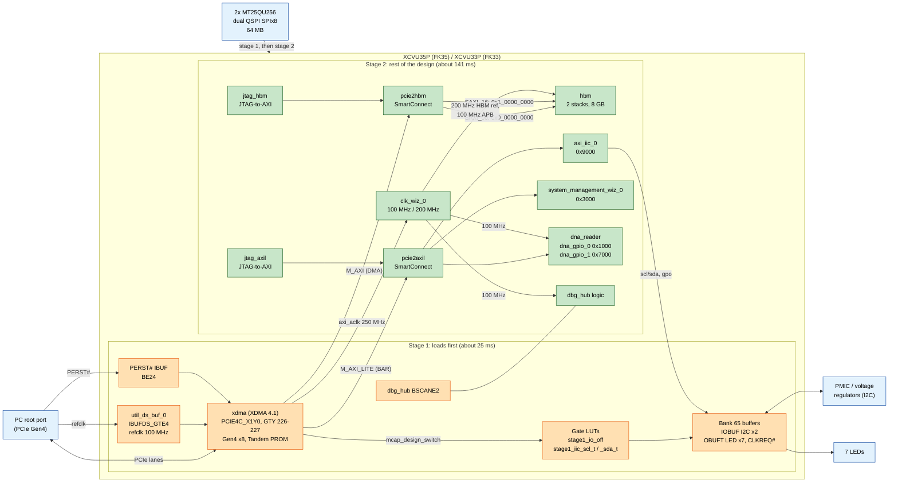
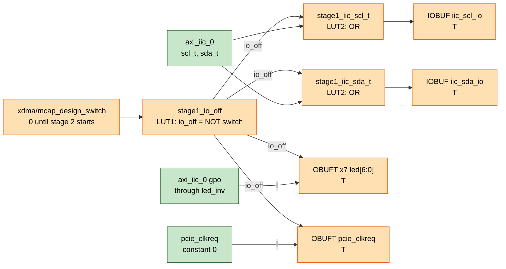

# PCIe Tandem PROM configuration (FK33 / FK35)

The example project can be built with **PCIe Tandem PROM** configuration: the FPGA loads the PCIe part of the
design first (stage 1) and the rest of the design afterwards (stage 2), both from the on-board QSPI flash. The PCIe
endpoint is up a few tens of milliseconds after power-on, so the PC finds the board even on a cold boot.

This page describes how Tandem PROM works on the Forest Kitten boards, what `projects/sqrl_fk_project.tcl` changes
in the design to make it pass the Tandem rules, and how to build, flash and check it.

- [Why Tandem](#why-tandem)
- [How Tandem PROM works](#how-tandem-prom-works)
- [Block diagram](#block-diagram)
- [What goes into stage 1](#what-goes-into-stage-1)
- [Bank 65 I/O gating](#bank-65-io-gating)
- [Floorplan](#floorplan)
- [What the project script does](#what-the-project-script-does)
- [Build, flash and check](#build-flash-and-check)
- [Build results](#build-results)
- [Known issue: design DNA in Tandem builds](#known-issue-design-dna-in-tandem-builds)
- [Tandem PCIe (stage 2 over PCIe)](#tandem-pcie-stage-2-over-pcie)
- [Notes for Vivado 2019.2](#notes-for-vivado-20192)
- [Files](#files)
- [References](#references)

## Why Tandem

A PCIe add-in card must be ready to train its link shortly after the slot is powered. The slot holds PERST# low for
at least 100 ms after power is stable, and the card must start link training within 20 ms after PERST# is released.
A board that is not configured by then is missing when the BIOS scans the bus, and most BIOSes do not scan again:
on the test PC (ASUS PRIME Z690-P) the slot is simply hidden.

The FK35 configures from two MT25QU256 flashes in dual QSPI (SPIx8) at 127.5 MHz, about 1 Gbit/s. The complete
example design is about 154 Mbit compressed, which takes about 150 ms to load: too late. With Tandem PROM only
stage 1 (26 Mbit) has to load before the PCIe block starts, which takes about 25 ms.

```mermaid
gantt
    title Power-on to PCIe link training, in ms (SPIx8 at 127.5 MHz, nominal)
    dateFormat x
    axisFormat %L
    section PCIe slot
    PERST held low (at least 100 ms)       :crit, perst, 0, 100
    Link training must start (20 ms)       :train, 100, 120
    section Without Tandem
    Full bitstream, 154 Mbit               :full, 0, 151
    section Tandem PROM
    Stage 1 (PCIe), 26 Mbit                :s1, 0, 25
    Stage 2 (rest of the design), 144 Mbit :s2, 25, 167
```



Times are counted from the end of the FPGA's power-on reset and use the nominal configuration clock (the internal
oscillator has a tolerance), so the real numbers vary a little. Stage 1 has plenty of margin; the full bitstream does not
make it.

## How Tandem PROM works

Vivado splits the bitstream into two parts that sit one after the other in the same flash image:

- **Stage 1** holds the PCIe hard block (PCIE4C_X1Y0), its GTY transceivers, the reference clock buffer, PERST#,
  everything in the configuration I/O bank (bank 65) and the configuration-site primitives. After stage 1 is loaded the
  FPGA starts it right away (a partial startup), and the PCIe endpoint trains the link and answers configuration
  requests from the host.
- **Stage 2** is the rest of the design (HBM, interconnects, peripherals). The configuration engine keeps reading it
  from the flash while stage 1 is already running. When stage 2 starts, the XDMA output `mcap_design_switch` goes high.



The operating system loads drivers seconds after the BIOS scan, long after stage 2 is running, so a driver always
finds the complete design.

## Block diagram

Stage 1 cells are orange, stage 2 cells are green. The XDMA AXI clock (`axi_aclk`, 250 MHz) and reset come from stage
1 and drive all of stage 2.



AXI-Lite address map (PCIe BAR of `M_AXI_LITE`, 128 KB, and `jtag_axil`):

| Offset | Block | Contents |
| --- | --- | --- |
| 0x1000 | dna_gpio_0 | DNA[31:0] (0x1000), DNA[63:32] (0x1008) |
| 0x3000 | system_management_wiz_0 | temperature and voltages |
| 0x7000 | dna_gpio_1 | DNA[95:64] (0x7000), ready (0x7008 bit 0) |
| 0x9000 | axi_iic_0 | I2C to the PMIC, GPO drives the LEDs (through `led_inv`) |

HBM (DMA `M_AXI` and `jtag_hbm`): stack 0 at 0x0_0000_0000 to 0x0_FFFF_FFFF through SAXI_00, stack 1 at
0x1_0000_0000 to 0x1_FFFF_FFFF through SAXI_16.

## What goes into stage 1

The XDMA IP puts its own logic into stage 1. The project adds the cells below, each required by a Tandem design rule.
The assignment is the cell property `HD.TANDEM_IP_PBLOCK`: `Stage1_Main` for logic, `Stage1_Config_IO` for I/O
buffers.

| Cell | Pin | Pblock | Why |
| --- | --- | --- | --- |
| `util_ds_buf_0` IBUFDS_GTE4 (PCIe refclk) | MGTREFCLK0 of quad 226 | Stage1_Main | The GTs and the PCIe block need their reference clock in stage 1. |
| PERST# input buffer | BE24 | Stage1_Config_IO | PCIe reset of the stage 1 endpoint. |
| `iic_scl_iobuf`, `iic_sda_iobuf` | BB24, BA24 | Stage1_Config_IO | Bank 65 is a configuration bank: all its I/O must be in stage 1 (DRC HDTC-10). |
| `led_obuft[0..6]` | BD25, BE26, BD23, BF26, BC25, BB26, BB25 | Stage1_Config_IO | Bank 65 (HDTC-10). |
| `pcie_clkreq_obuft` | BE25 | Stage1_Config_IO | Bank 65 (HDTC-10). |
| `stage1_io_off`, `stage1_iic_scl_t`, `stage1_iic_sda_t` | | Stage1_Main | Stage 1 outputs driven by stage 2 logic must stay tri-stated until stage 2 is up (HDTC-11), see below. |
| Debug hub `BSCANE2` | | Stage1_Main | Configuration-site primitives must be in stage 1 (HDTC-12). |

## Bank 65 I/O gating

Stage 1 I/O buffers are configured and active as soon as stage 1 starts, but the logic that drives them (AXI I2C, LED
GPO, the CLKREQ# constant) only exists after stage 2 starts. Until then those inputs are undefined, so the buffers
must be tri-stated. `projects/hdl/bd_wrapper_tandem.v` replaces the generated `bd_wrapper` (same module and instance
names) and puts explicit tri-state buffers behind a gate driven by `mcap_design_switch`:



| `mcap_design_switch` | I2C | LEDs | CLKREQ# |
| --- | --- | --- | --- |
| 0 (stage 2 loading) | released (bus pull-ups) | off, outputs Hi-Z | not driven |
| 1 (stage 2 running) | driven by axi_iic_0 | driven by axi_iic_0 GPO | driven low |

The gate LUTs are instantiated primitives with `DONT_TOUCH`, so synthesis keeps them and the constraints can find them
by name. The I2C IOBUFs are assigned as whole macros: Vivado does not accept pblock assignments of the cells inside an
IOBUF.

## Floorplan

The XDMA IP creates the stage 1 pblock `Stage1_main` next to PCIE4C_X1Y0 in SLR0, the master SLR: CLB columns X199 to
X232, rows Y0 to Y239, the GTY quads 224 to 227 and the configuration site. Stage 2 logic cannot be placed in it.

```text
          XCVU35P (2 SLRs), not to scale                 right edge
 +-----------------------------------------------------+
 | SLR1                                                |
 |                                                     |  GTY quads
 |                     stage 2 logic                   |  of SLR1
 |                                                     |
 +-----------------------------------------------------+
 | SLR0 (master)                    +----------------+ |
 |                                  | Stage1_main    | |  GTY 227 (lanes 0-3)
 |        stage 2 logic             | SLICE X199-X232| |  GTY 226 (lanes 4-7, refclk)
 |                                  | Y0-Y239        | |  GTY 225 (x16 only)
 |                                  | PCIE4C_X1Y0    | |  GTY 224 (x16 only)
 |                                  | CONFIG_SITE    | |
 |                                  +----------------+ |
 |  HBM stack 0          HBM stack 1 (X31Y0 BLI sites  |
 |                       removed from Stage1_main)     |
 +-----------------------------------------------------+
```

Changes against the non-Tandem project:

- **No `pblock_bd_i`.** The factory constraints put the whole block design into a pblock that overlapped the stage 1
  region. It is commented out in `projects/sqrl_fk.xdc`.
- **HBM stack 1 corner.** HBM stack 1 is one hard macro whose AXI 15 and APB cells sit on `BLI_HBM_AXI_INTF_X31Y0` and
  `BLI_HBM_APB_INTF_X31Y0`, inside the IP's stage 1 pblock. The HBM is stage 2 logic, so placement failed (Place
  30-1093) until those two sites were removed from the pblock.
- **Snapping.** `SNAPPING_MODE ON` aligns the stage 1 pblock to programmable-unit boundaries (DRC HDTC-18).

## What the project script does

With `set PCIeTandem PROM` (the default on this branch), `projects/sqrl_fk_project.tcl` does the following on top of
the normal PCIe project:

1. **XDMA:** `CONFIG.mode_selection Advanced`, `CONFIG.mcap_enablement Tandem_PROM`, block location `PCIE4C_X1Y0`
   (the Tandem-capable PCIe block on VU33P/VU35P), and `mcap_design_switch` made external.
2. **Top level:** `projects/hdl/bd_wrapper_tandem.v` instead of the generated wrapper, with the `LANES` generic set
   from `PCIeLanes`.
3. **`sqrl_fk_tandem.xdc`** (generated in the project folder, implementation only): the `HD.TANDEM_IP_PBLOCK`
   assignments above, `SNAPPING_MODE ON`, and the removal of the two HBM sites from the stage 1 pblock.
4. **`tandem_place_pre.tcl`** (a `place_design` pre-hook): puts the debug hub's BSCANE2 into stage 1. The debug hub is
   inserted during implementation, after the constraint files are read, so the XDC cannot reach it. The hook is set
   after `set_property strategy`, because setting a strategy clears the step hooks.
5. **Flash image:** after `write_bitstream`, `write_flash_image.tcl` writes `bd_wrapper_primary.mcs/.prm` and
   `bd_wrapper_secondary.mcs/.prm` (SPIx8, 64 MB). With Tandem PROM the image is the normal `bd_wrapper.bit`, which
   holds both stages.

Configuration settings stay in `projects/sqrl_fk.xdc`: SPIx8, 4-byte addressing, compression and CONFIGRATE 127.5. The
Tandem IP constraints set `CONFIG_MODE SPIx4`, but they are processed early, so `sqrl_fk.xdc`'s `SPIx8` wins.

## Build, flash and check

1. Set the options at the top of `projects/sqrl_fk_project.tcl` (`Board`, `PCIeLanes`, `PCIeGen`,
   `PCIeTandem PROM`) and source it in Vivado 2019.2, then run synthesis, implementation and bitstream generation.
   The flash images are written next to the bitstream in `SQRL_FK35.runs/impl_1`.
2. Program the flashes and boot from them. With the board in the PC, run from the project folder (the project script
   copies the scripts there), in an administrator prompt:

   ```bat
   cd SQRL_FK35
   sqrl_fk_program_flash_pc.bat
   ```

   It disables the board's PCI device, programs and verifies both flashes, boots the FPGA from them (stage 1, then
   stage 2), and re-enumerates the device without restarting Windows. Without the board in a PC,
   `sqrl_fk_program_flash.bat` does the flashing and boot only.
3. Power the PC fully off and on. The board must appear in Device Manager as `PCI\VEN_1E24&DEV_1533` (vendor 1E24,
   device 1533, class 12 "processing accelerator"; no driver is installed for it).
4. Check that stage 2 runs: `sqrl_fk_read_dna.bat` reads the design's DNA registers over JTAG-to-AXI; `ready=1` means
   the stage 2 logic is clocked and running.

## Build results

Example build: FK35, Gen4 x8, Vivado 2019.2.1.

| Item | Value |
| --- | --- |
| Timing | WNS +0.087 ns, WHS +0.010 ns (met) |
| Tandem DRCs | none left |
| Stage 1 | 25,989,888 bits, about 25 ms at SPIx8 127.5 MHz |
| Stage 2 | 144,084,608 bits, about 141 ms |
| `bd_wrapper.bit` | 21,259,455 bytes, compressed, both stages |
| Flash image | 10.1 MB in each flash (0x000000 to 0xA2324B) |
| Same design without Tandem | about 19.2 MB, about 150 ms to load |

On the test PC the link comes up at Gen4 x4 (the chipset slot has four lanes).

## Known issue: design DNA in Tandem builds

Each SLR die of a multi-SLR device has its own DNA. The DNA that Vivado shows as `REGISTER.EFUSE.FUSE_DNA` is the
master SLR's, which is SLR0 on the VU35P. SLR0's configuration site (`CONFIG_SITE_X0Y0`) is inside the stage 1 pblock,
where it also holds the debug hub's BSCANE2. The stage 2 `DNA_PORTE2` of `dna_reader` therefore went into SLR1's
configuration site (`CONFIG_SITE_X0Y1`), and the Tandem build reports the DNA of the SLR1 die: same upper bits (lot and
wafer), different lower bits. `sqrl_fk_read_dna.bat` shows it as "differs from eFUSE".

Fix (not built yet): place `DNA_PORTE2` at `CONFIG_SITE_X0Y0` and assign it to stage 1. The non-Tandem builds leave
the choice to the placer too, so the location constraint belongs in every build.

## Tandem PCIe (stage 2 over PCIe)

`set PCIeTandem PCIe` builds the other Tandem mode: only stage 1 is in the flash, and a host driver loads stage 2 through
the PCIe block's MCAP. The script then sets `HD.TANDEM_BITSTREAMS Separate`, writes `bd_wrapper_tandem1.bit` and
`bd_wrapper_tandem2.bit`, and puts only stage 1 into the flash image (`sqrl_fk_program_flash.tcl` picks the stage 1
file too). This mode is not tested on the board: it needs an MCAP driver on the host to send stage 2.

## Notes for Vivado 2019.2

- The scripts on this branch use Vivado 2019.2 (any 2019.2 update) and its IP versions: XDMA 4.1.
- PG213 lists a Vivado 2019.2 problem with UltraScale+ stage 2 bitstreams that are reloaded at run time (Tandem with
  Field Updates). Tandem PROM loads both stages once at power-on and does not use Field Updates.
- In 2019.2 a scripted GUI build needs `generate_target` and `create_ip_run` on the block design before `launch_runs`,
  otherwise the out-of-context IP runs are missing and synthesis fails.

## Files

| File | Purpose |
| --- | --- |
| `projects/sqrl_fk_project.tcl` | Creates the project; `PCIeTandem` selects None, PROM or PCIe. |
| `projects/hdl/bd_wrapper_tandem.v` | Tandem top level with the bank 65 gating. |
| `projects/sqrl_fk.xdc` | Pins, configuration settings; `pblock_bd_i` disabled for Tandem. |
| `SQRL_<Board>/sqrl_fk_tandem.xdc` | Generated: stage 1 assignments, snapping, HBM sites. |
| `SQRL_<Board>/tandem_place_pre.tcl` | Generated: debug hub BSCANE2 to stage 1. |
| `SQRL_<Board>/write_flash_image.tcl` | Generated: write_cfgmem after write_bitstream. |
| `scripts/sqrl_fk_program_flash*.bat/.tcl` | Program the flashes and boot; the `_pc` version handles the board in a PC. |
| `scripts/sqrl_fk_read_dna.bat/.tcl` | Read the device DNA over JTAG and from the design. |

## References

- AMD/Xilinx PG213, UltraScale+ Devices Integrated Block for PCI Express: chapter "Tandem Configuration".
- AMD/Xilinx PG195, DMA/Bridge Subsystem for PCI Express (XDMA).
- PCI Express Card Electromechanical Specification (power and PERST# timing) and PCI Express Base Specification
  (link training after reset).
